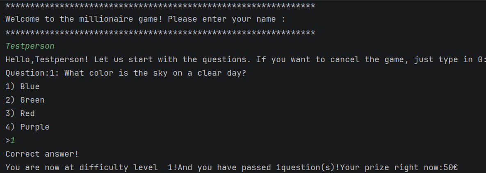
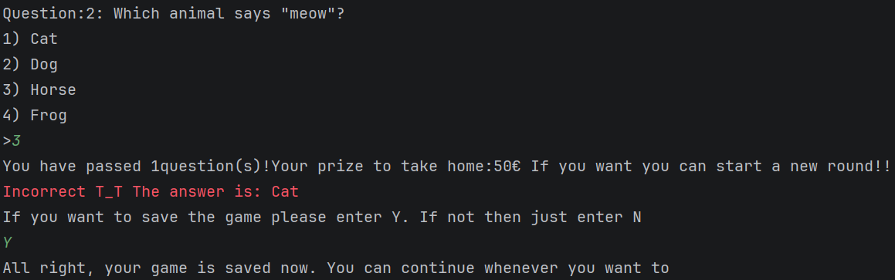
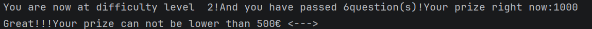
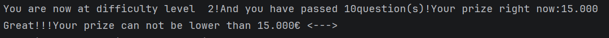
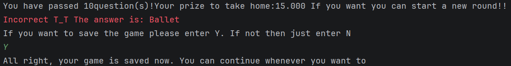
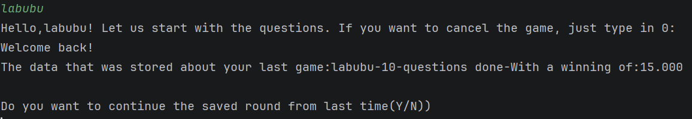

# Millionärsspiel – Java

Ein Konsolen-basiertes Quizspiel, das an das bekannte Fernsehformat „Wer wird Millionär?“ angelehnt ist. 
Ziel des Spiels ist es, durch die richtige Beantwortung von 15 Multiple-Choice-Fragen den Hauptgewinn von einer Million Euro zu erreichen.

Das Projekt wurde im Rahmen des Softwarequality Moduls zum Einstieg in Java entwickelt.

## Spielprinzip

Zu Beginn des Spiels gibt der Spieler seinen Namen ein. 
Anschließend werden nacheinander Multiple-Choice-Fragen gestellt. 
Jede Frage bietet vier Antwortmöglichkeiten, von denen genau eine richtig ist.

Der Spieler beantwortet die Fragen durch Eingabe der entsprechenden Nummer (1–4).

- Bei einer richtigen Antwort steigt der Spieler zur nächsten Frage auf und der Gewinn erhöht sich.
- Bei einer falschen Antwort endet die Runde.
  
- Nach einer falschen Antwort kann der Spieler entscheiden, ob der aktuelle Spielstand gespeichert werden soll.
- Durch Eingabe von `0` kann das Spiel abgebrochen werden.

- Nach erfolgreicher Beantwortung aller 15 Fragen gewinnt der Spieler eine Million Euro.

## Schwierigkeitsstufen und Gewinnstufen

Das Spiel ist in drei Schwierigkeitsstufen unterteilt:

| Fragen | Schwierigkeitsstufe |
|---|---|
| 1–5 | Level 1 |
| 6–10 | Level 2 |
| 11–15 | Level 3 |

Mit jeder richtig beantworteten Frage steigt der mögliche Gewinn.

Zusätzlich gibt es zwei Sicherheitsstufen:
- Nach der 6. richtig beantworteten Frage wird ein Mindestgewinn von 500 € erreicht.

- Nach der 10. richtig beantworteten Frage wird ein Mindestgewinn von 15.000 € erreicht.

## Speichern und Fortsetzen

Das Spiel bietet die Möglichkeit, den Spielfortschritt zu speichern und zu einem späteren Zeitpunkt fortzusetzen.

Dafür wird die Java-Serialisierung verwendet.

Der Spielstand wird in der Datei `playerData.ser` gespeichert. Folgende Informationen werden dabei berücksichtigt:

- Name des Spielers
- Anzahl der bereits richtig beantworteten Fragen
- Aktueller Gewinn

Beim nächsten Spielstart wird überprüft, ob bereits ein gespeicherter Spielstand existiert.
Wenn der eingegebene Name mit dem gespeicherten Spielernamen übereinstimmt, kann der Spieler entscheiden, ob er die vorherige Runde fortsetzen oder ein neues Spiel beginnen möchte.

## Verwendete Technologien

- **Java** – Programmiersprache
- **Java I/O** – Einlesen der Fragen und Speichern der Spielstände
- **Java Serialization** – Speichern und Laden von Spielerobjekten
- **Java Collections Framework** – Verwaltung der Fragen mithilfe einer `ArrayList`
- **Scanner** – Verarbeitung der Benutzereingaben über die Konsole

## Projektstruktur

```text
MillionaireGame/
│
├── src/
│   ├──Answer.java
│   ├── Game.java
│   ├── MillionaireGame.java
│   ├── Player.java
│   ├── Question.java
│   └── QuestionManager.java
│
├── questions.txt
├── playerData.ser
└── README.md
```

**Beschreibung der Klassen:**

| Klasse | Aufgabe |
|---|---|
| `MillionaireGame` | Einstiegspunkt des Programms. Erstellt ein Game-Objekt und startet das Spiel. |
| `Game` | Steuert den gesamten Spielablauf, verarbeitet Spielereingaben und verwaltet den Spielstand. |
| `Player` | Repräsentiert einen Spieler und speichert Name, beantwortete Fragen und aktuellen Gewinn. |
| `Question` | Repräsentiert eine einzelne Frage mit Fragetext, Antwortmöglichkeiten und Lösungsindex. |
| `QuestionManager` | Lädt die Fragen aus der Textdatei und verwaltet deren Ausgabe und Überprüfung. |
| `Answer` | Ursprünglich für die Darstellung von Antworten vorgesehen, wird in der aktuellen Implementierung nicht aktiv verwendet. |

## Aufbau der Fragen-Datei

Die Fragen werden aus der Datei `questions.txt` eingelesen.

Jede Frage besteht aus sechs Zeilen:

1. Fragetext
2. Richtige Antwort
3. Falsche Antwort 1
4. Falsche Antwort 2
5. Falsche Antwort 3
6. Schwierigkeitsstufe

Die richtige Antwort wird in der aktuellen Implementierung immer an der ersten Position des Antwort-Arrays gespeichert. Der Lösungsindex ist daher standardmäßig `0`.

Die Schwierigkeitsstufe wird aus der Textdatei eingelesen. Die Einteilung der tatsächlichen Spielstufen erfolgt im Spiel anhand der Anzahl der bereits richtig beantworteten Fragen.

## ▶️ Installation und Ausführung

### Voraussetzungen

- Installiertes Java Development Kit (JDK)
- Eine Java-Entwicklungsumgebung, beispielsweise IntelliJ IDEA
- Die Datei `questions.txt` mit den entsprechenden Fragen

### Projekt starten

1. Repository klonen:

```bash
git clone https://github.com/SaZahed/Millionenshow.git
```

2. Das Projekt in IntelliJ IDEA oder einer anderen Java-IDE öffnen.

3. Sicherstellen, dass sich `questions.txt` im Arbeitsverzeichnis befindet.

4. Die Klasse `MillionaireGame.java` ausführen.

5. Den Anweisungen in der Konsole folgen und das Spiel starten.

## Verwendete objektorientierte Konzepte

Im Projekt werden verschiedene Konzepte der objektorientierten Programmierung eingesetzt:

- **Klassen und Objekte:** Spieler, Fragen und das Spiel selbst werden durch eigene Klassen repräsentiert.
- **Kapselung:** Die Verwaltung der Spielerdaten erfolgt über Getter und Methoden zur Aktualisierung der Attribute.
- **Komposition:** Die Game-Klasse verwendet unter anderem Player- und QuestionManager-Objekte.
- **Listen und Arrays:** Fragen werden in einer Liste verwaltet, Antwortmöglichkeiten und Gewinnstufen in Arrays gespeichert.
- **Serialisierung:** Spielerobjekte können gespeichert und wieder geladen werden.

**Viel Spaß beim Spielen!**